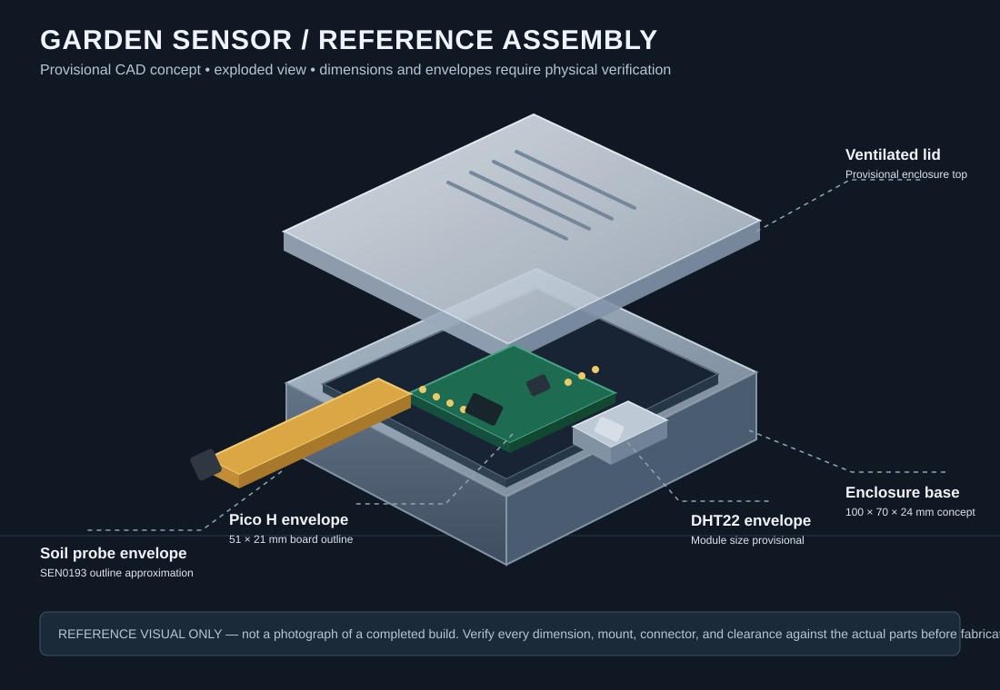
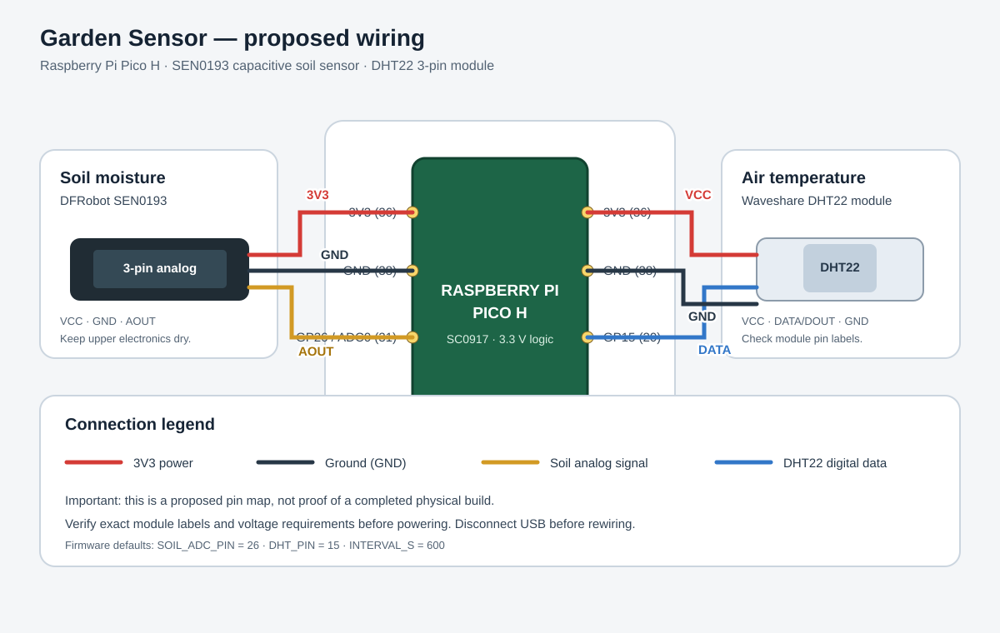

# Garden Sensor

A small, low-cost sensor station that measures **TODO: what it measures, e.g. soil moisture and air temperature** in a garden bed and **TODO: what it does with the readings, e.g. logs them to a file / shows them on a screen**, so watering and planting decisions can be based on data instead of guesswork.

> **Status:** Waiting for grants. Then building.
<!-- TODO: add a photo or two of the finished build, and a screenshot of the readings.
     Before uploading photos, remove location data (EXIF) and don't show your house number or street. -->

## Why I'm building this

TODO: two or three honest sentences about the problem you want to solve. For example, what goes wrong when you water by feel, or what you'd like to know about your garden that you can't see now.

## What it does

Only list what is actually working. Move anything unfinished to the roadmap.

- [ ] TODO: Measures **...** every **...** minutes
- [ ] TODO: Stores readings in **...** (CSV file on an SD card, serial output, etc.)
- [ ] TODO: Shows or sends them by **...**

## Hardware

| Part | Qty | What it's for | Notes |
|---|---|---|---|
| TODO: microcontroller board | 1 | Runs the firmware | |
| TODO: soil moisture sensor | 1 | Measures how wet the soil is | Needs calibration, see below |
| TODO: temperature (and humidity) sensor | 1 | Air conditions | |
| TODO: power (battery pack / USB supply) | 1 | | |
| TODO: weatherproof enclosure | 1 | Protects the electronics | |
| TODO: wires, connectors, screws | | | |

**Estimated cost:** TODO (add up the real prices; say if any parts were donated or granted).

## How it works

```
[soil sensor] ──┐
                ├──> [microcontroller] ──> [storage / display]
[air sensor]  ──┘            ▲
                        [power supply]
```

TODO: replace the diagram above if your design is different, then add two or three sentences on what the firmware does each cycle (wake, read sensors, convert, save, sleep).

## Wiring

| Sensor / part | Sensor pin | Board pin |
|---|---|---|
| TODO | TODO | TODO |

TODO: add a wiring diagram or photo in `docs/`.

## Build it yourself

1. **Get the parts** listed above.
2. **Make the case.** TODO: link to the CAD or print files in this repo (for example `hardware/`).
3. **Wire it** following the table above. Double-check power polarity before connecting anything.
4. **Flash the firmware.** TODO: tool and commands, for example:
   ```
   TODO: the exact steps to upload the code to your board
   ```
5. **Calibrate the soil sensor.** Read the sensor in dry air and again in a glass of water, and put those two raw values in `TODO: config file`. Different sensors and different soils read differently, so don't skip this.
6. **Put it in the garden bed** and check that the readings change when you water.

## Configuration

Settings such as the reading interval and calibration values live in `TODO: config file name`.

**Never commit secrets** (Wi-Fi passwords, API keys). Keep them in a file that is listed in `.gitignore`, and commit a copy with fake values, such as `config.example.py`.

## Data format

Readings are saved one per line. Example (edit to match your real output):

```
timestamp,soil_moisture_raw,soil_moisture_pct,air_temp_c
2026-01-01T08:00:00,TODO,TODO,TODO
```

## Accuracy and known limits

Be specific about what you actually checked. For example:

- TODO: how you checked the soil readings (for example, weighing a pot of soil dry and wet, or comparing with a hand test)
- TODO: how long it has run outdoors, and what failed (condensation, battery life, sensor drift, wires coming loose)
- TODO: anything you know it does *not* measure well

## Repository layout

```
TODO: adjust to your real folders
firmware/     code that runs on the board
hardware/     case files, wiring diagrams
docs/         photos, build notes
data/         example readings
```

## Build log

TODO: link to your journal or build notes, with dates and hours, showing the real process including what didn't work.

## Roadmap

- [ ] TODO: next improvement
- [ ] TODO: another one

## License

TODO: choose and add a `LICENSE` file. Common choices are MIT for code and CERN-OHL or CC BY for hardware designs.

## Credits

TODO: credit libraries, tutorials, and designs you used or adapted, with links. If a program or sponsor provided parts or funding, you can thank them here, and some programs ask you to.


---

## Project files, CAD, and diagrams

The links below point to the current repository files. The assembly artwork is a **provisional CAD reference**, not a photograph or a claim that the physical device has been assembled or fit-tested.

### Assembly reference



- [Editable FreeCAD source assembly (.FCStd)](garden-sensor/hardware/garden_sensor_reference_assembly.FCStd)
- [Fusion 360 editable-source generator (.py)](garden-sensor/hardware/create_fusion_source.py) — run inside Fusion 360, then save the generated design as `.f3d` for the Fabricate checker.
- [STEP assembly export (.step)](garden-sensor/hardware/garden_sensor_reference_assembly.step)
- [STL preview (.stl)](garden-sensor/hardware/garden_sensor_reference_assembly.stl)
- [CadQuery source generator](garden-sensor/hardware/generate_reference_model.py)
- [FreeCAD macro source](garden-sensor/hardware/generate_reference_assembly.FCMacro)
- [Reference assembly assumptions and limitations](garden-sensor/hardware/REFERENCE_ASSEMBLY.md)

### Wiring



- [Wiring instructions](garden-sensor/docs/wiring.md)
- [BOM (CSV)](bom.csv)

### Firmware and tests

- [MicroPython firmware](garden-sensor/firmware/main.py)
- [Sensor calibration and CSV logic](garden-sensor/firmware/logic.py)
- [Example configuration](garden-sensor/firmware/config.example.py)
- [Unit tests](garden-sensor/tests/test_logic.py)
- [CSV plotting tool](garden-sensor/tools/plot_readings.py)

### PCB design status

This project does not have a custom hand-routed PCB. It uses an off-the-shelf Raspberry Pi Pico H development board and separate sensor modules connected with jumper wires. No project-specific KiCad/EasyEDA schematic, PCB layout, or Gerber manufacturing files exist. The Pico's own circuit board is a commercially manufactured development board, not a PCB designed for this project. See [the PCB design status note](garden-sensor/docs/pcb_status.md).

There is therefore no project-designed PCB screenshot to include. The wiring diagram above documents the connections between the development board and the sensor modules.
